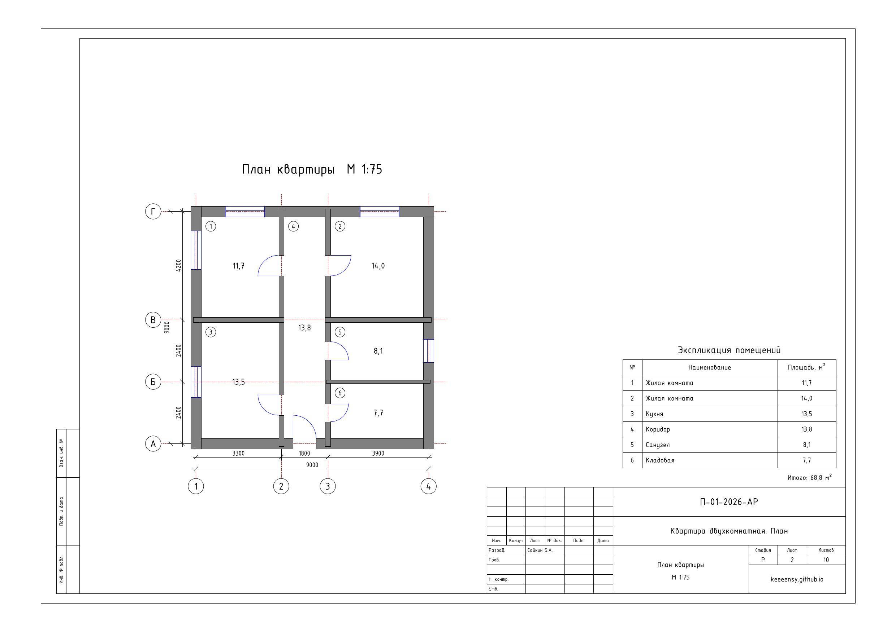
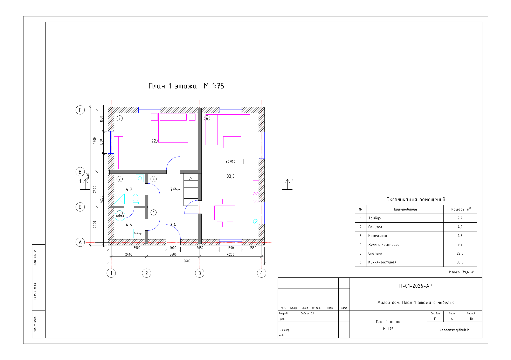
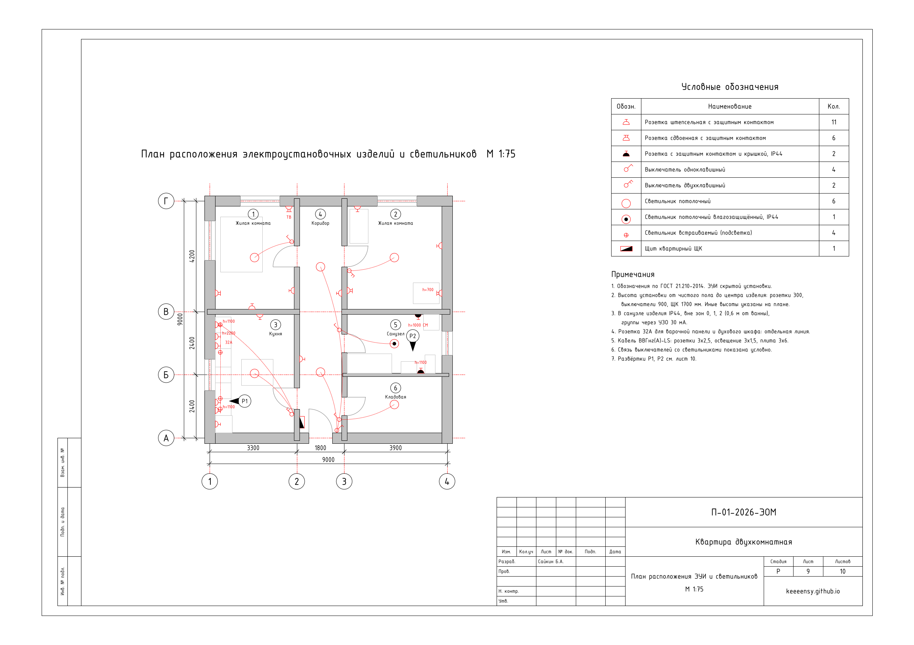
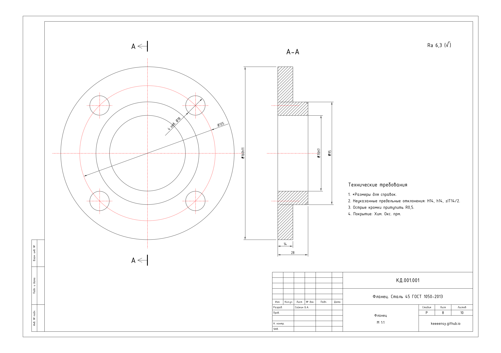

# Портфолио чертежей AutoCAD

10 листов A3 в DXF (открываются в AutoCAD, nanoCAD, КОМПАС) и PNG для просмотра. Рамка и основная надпись по форме 3 ГОСТ Р 21.101-2020, планы в масштабе 1:100, электрика по ГОСТ 21.210-2014.

| № | Лист |
|---|---|
| 01 | Однокомнатная квартира, план |
| 02 | Двухкомнатная квартира, план |
| 03 | Жилой дом, план 1 этажа |
| 04 | Жилой дом, план 2 этажа |
| 05 | Баня, план |
| 06 | Жилой дом, план с расстановкой мебели |
| 07 | Жилой дом, фасад |
| 08 | Фланец, машиностроительный чертёж |
| 09 | Квартира, электрика: розетки, освещение, щит |
| 10 | Развёртки стен кухни и санузла |

Все DXF одним архивом: `out/AutoCAD_portfolio_DXF.zip`.

## Примеры






## Как пересобрать

Листы генерируются скриптами на Python (ezdxf):

```bash
pip install ezdxf matplotlib
python make_plans.py   # листы 01-05
python make_pro.py     # листы 06-08
python make_eng.py     # листы 09-10
```
